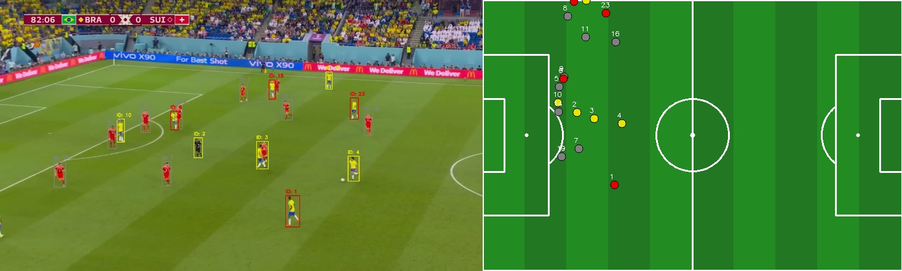
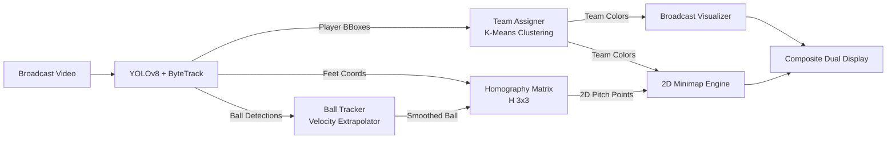

# Tactical Football Match Analyzer ⚽🎯

[](https://www.python.org/)
[](https://pytorch.org/)
[](https://docs.ultralytics.com/)
[](https://opencv.org/)
[](https://scikit-learn.org/)
[](https://developer.nvidia.com/cuda-toolkit)
[](LICENSE)

An end-to-end Computer Vision and Sports Analytics pipeline that transforms single-camera broadcast football footage into an accurate, real-time **2D Tactical Pitch Minimap**. 

The system detects and tracks players using **YOLOv8 + ByteTrack**, isolates and clusters jersey colors via **K-Means in HSV/BGR space** to separate teams and match officials, tracks the football through motion blur via **damped velocity extrapolation**, and projects ground-contact coordinates onto a **metric FIFA 2D pitch** using planar **Homography transformations**.

---

## 📸 Tactical Output Preview


*Figure 1: Dual tactical display showing original broadcast footage with tracked player IDs and custom team bounding boxes (left) alongside the real-time orthographic 2D tactical minimap with player coordinates and ball trajectory (right).*

---

## ⚡ Key Features

- **🚀 State-of-the-Art Detection & Tracking**: Leverages `YOLOv8m` with persistent **ByteTrack** for high-precision multi-object tracking of players and the football.
- **👕 Unsupervised Team Color Clustering**: Isolates jersey regions and clusters pixel distributions via K-Means to automatically group players into **Team A**, **Team B**, and **Referees**.
- **📐 Planar Homography Projection**: Mathematically projects player feet positions onto a top-down $105\text{m} \times 68\text{m}$ pitch model using 4-point perspective transformations.
- **⚽ Temporal Ball Continuity**: Implements momentum-based velocity extrapolation and trajectory memory to track the ball through high-speed passes, shots, and camera blur.
- **🎯 Interactive Calibration Tool**: Built-in dual-window GUI (`calibrate.py`) for calibrating any broadcast camera angle to physical pitch landmarks in seconds.
- **🖥️ Flexible Deployment**: Runs with interactive desktop visualization (`cv2.imshow`), headless server mode (`--no-display`), and direct MP4 export (`--output`).
- **⚡ Hardware Acceleration**: Automatically utilizes NVIDIA CUDA GPUs with seamless CPU fallback.

---

## 🏗️ Architecture Overview



For complete architectural specifications, data flows, and design rationale, see [docs/ARCHITECTURE.md](docs/ARCHITECTURE.md).

---

## 📂 Repository Structure

```
football-analyzer/
├── main.py                      # Main pipeline runner and CLI entrypoint
├── calibrate.py                 # Interactive two-window homography calibration tool
├── calibration.json             # Calibrated video-to-pitch coordinate mapping
├── requirements.txt             # Pinned Python package dependencies
├── .gitignore                   # Git exclusions (weights, virtual environments, cache)
├── MEMORY.md                    # Project memory, decisions, and development journal
├── README.md                    # Repository documentation and guide
│
├── src/
│   ├── __init__.py              # Package marker
│   ├── detection.py             # MatchAnalyzer: YOLOv8 + ByteTrack integration
│   ├── ball_tracker.py          # BallTracker: Temporal memory and trajectory prediction
│   ├── team_assigner.py         # TeamAssigner: Jersey color extraction and clustering
│   ├── camera_transformation.py # CameraTransformation: Homography and coordinate projection
│   └── minimap.py               # Minimap: 2D tactical pitch drawing with ball trails
│
├── data/
│   └── test_match.mp4           # Sample benchmark broadcast match video
│
├── assets/
│   └── demo_preview.jpg         # Visual demonstration screenshot
│
└── docs/
    ├── ARCHITECTURE.md          # Technical pipeline architecture and module guide
    ├── CALIBRATION_GUIDE.md     # Comprehensive two-window pitch calibration tutorial
    └── ALGORITHMS.md            # Mathematical formulations (Homography, K-Means, ByteTrack)
```

---

## 🛠️ Installation & Setup

### 1. Prerequisites
- Python 3.10, 3.11, or 3.12
- Git
- NVIDIA GPU with CUDA drivers (optional, but recommended for real-time 30+ FPS inference)

### 2. Clone the Repository
```bash
git clone https://github.com/M23adi/football-analyzer.git
cd football-analyzer
```

### 3. Create a Virtual Environment
```bash
# Windows
python -m venv venv
.\venv\Scripts\activate

# Linux / macOS
python3 -m venv venv
source venv/bin/activate
```

### 4. Install Dependencies
```bash
pip install -r requirements.txt
```

> **Note on Model Weights**: When you first run the program, Ultralytics will automatically download `yolov8m.pt` (approx. 50 MB) directly from official GitHub releases.

---

## 🚀 Quickstart & Usage

### 1. Run Live Tactical Analysis
To process the bundled benchmark video (`data/test_match.mp4`) with real-time on-screen visualization:

```bash
python main.py
```

### 2. Export to Video File
Export the side-by-side tactical video to an `.mp4` file:

```bash
python main.py --output tactical_output.mp4
```

### 3. Run Headless (Servers, Docker, CI/CD)
To process video without opening a GUI display window:

```bash
python main.py --output tactical_output.mp4 --no-display
```

### 4. Full Command-Line Options

```bash
python main.py --help
```

| Argument | Type | Default | Description |
| :--- | :--- | :--- | :--- |
| `--video` | `str` | `data/test_match.mp4` | Path to input match video. |
| `--calibration` | `str` | `calibration.json` | Path to calibration JSON file. |
| `--output` | `str` | `None` | Optional path to export processed video (`.mp4`). |
| `--model` | `str` | `yolov8m.pt` | YOLO model weights (`yolov8n.pt`, `yolov8m.pt`, etc.). |
| `--device` | `str` | `None` (auto) | Computation device (`'cuda'`, `'cpu'`). |
| `--conf` | `float` | `0.2` | Detection confidence threshold. |
| `--scale` | `float` | `6.5` | Minimap scale factor in pixels per meter. |
| `--no-display` | `flag` | `False` | Run in headless mode without desktop window. |
| `--max-frames` | `int` | `None` | Max number of frames to process before stopping. |

---

## 📐 Camera Calibration Workflow

If you want to analyze a new match video or stadium angle, run the interactive calibration tool:

```bash
python calibrate.py --video path/to/your_match.mp4 --output calibration.json
```

1. **Window 1 (Video Frame)**: Click on a recognizable pitch marking (e.g. 18-yard box corner).
2. **Window 2 (Pitch Diagram)**: Click the **same** marking on the 2D pitch diagram.
3. Repeat for **4 points**.
4. Press any key to save. Your `calibration.json` is ready!

> For full calibration guidelines, optimal point selection, and pitch geometry, consult the [Calibration Guide](docs/CALIBRATION_GUIDE.md).

---

## 🧠 Module Deep Dive

### 1. `src/detection.py` (MatchAnalyzer)
Wraps YOLOv8 and ByteTrack. Processes each frame to detect players (`class 0`) and the ball (`class 32`). Assigns continuous track IDs across frames and handles bounding box drawing with high-contrast text badges.

### 2. `src/team_assigner.py` (TeamAssigner)
Extracts jersey colors by taking the upper half of player bounding boxes, running K-Means clustering in BGR space, and scoring clusters in HSV space (penalizing green turf and dark shadows). Automatically clusters players into Team A, Team B, and Referees.

### 3. `src/camera_transformation.py` (CameraTransformation)
Computes the $3 \times 3$ planar homography matrix $\mathbf{H}$ using `cv2.findHomography`. Converts player feet coordinates $(\frac{x_1 + x_2}{2}, y_2)$ into top-down metric pitch coordinates $(x', y')$. Also computes $\mathbf{H}^{-1}$ for inverse camera projection.

### 4. `src/ball_tracker.py` (BallTracker)
Maintains temporal continuity for the football. Estimates ball velocity using an exponential moving average (EMA) and applies damped momentum extrapolation when the ball is temporarily occluded or blurred.

### 5. `src/minimap.py` (Minimap)
Draws a regulation FIFA football pitch ($105\text{m} \times 68\text{m}$) complete with penalty boxes, center circle, penalty arcs, and grass stripes. Renders player dots with drop shadows, jersey colors, ID numbers, and glowing ball markers with faded flight trails.

---

## 📚 Detailed Documentation

- **[Architecture & Pipeline Specification](docs/ARCHITECTURE.md)**: Deep dive into the modular system design and data pipelines.
- **[Camera Calibration Guide](docs/CALIBRATION_GUIDE.md)**: Tutorial on perspective mapping and optimal reference point selection.
- **[Mathematical & Algorithmic Foundations](docs/ALGORITHMS.md)**: Explanations of Homography, ByteTrack, and K-Means color spaces.
- **[Project Memory & Developer Notes](MEMORY.md)**: Design decisions, trade-offs, and future milestones.

---

## 🗺️ Roadmap & Future Enhancements

- [ ] **Dynamic Camera Motion Compensation**: Background feature tracking (ORB/SIFT) or optical flow to handle panning, tilting, and zooming cameras dynamically.
- [ ] **Voronoi Pitch Dominance**: Compute 2D Voronoi polygons around players to visualize space ownership and passing options.
- [ ] **Physical Metrics Engine**: Compute player top sprint speeds ($\text{km/h}$), total distance covered, and sprint count.
- [ ] **Player Tactical Heatmaps**: Gaussian density heatmaps representing defensive and offensive spatial occupation over time.

---

## 📄 License

This project is licensed under the MIT License - see the [LICENSE](LICENSE) file for details.
