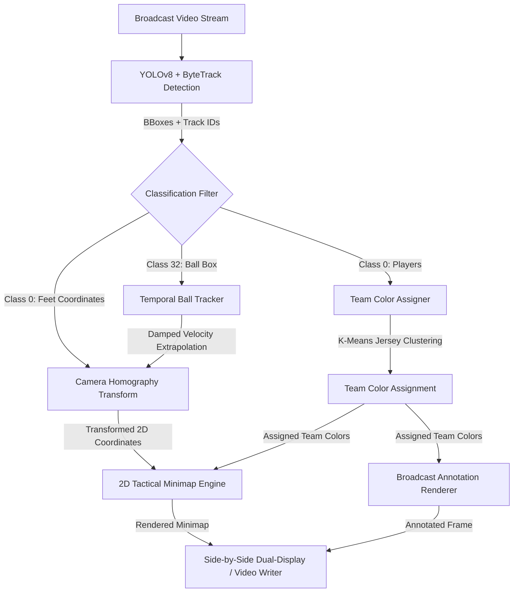

# System Architecture & Design Specification

## Overview

The **Tactical Football Match Analyzer** is an end-to-end computer vision and sports analytics pipeline designed to convert standard single-camera broadcast football footage into a real-time, metric-accurate 2D tactical radar minimap.

The core engineering principle is **modular decoupling**: each component in the pipeline handles an isolated analytical stage (detection, temporal tracking, jersey clustering, perspective geometry transformation, and tactical visualization).

---

## High-Level Pipeline Architecture

---

## Detailed Component Breakdown

### 1. Object Detection & Multi-Object Tracking (`src/detection.py`)
- **Engine**: Ultralytics YOLOv8 (`yolov8m.pt` by default, configurable to `yolov8n.pt` or custom models).
- **Tracker**: ByteTrack running persistently (`persist=True`). ByteTrack associates low-score detection boxes with prior tracklets instead of simply discarding them, which drastically reduces ID switches during player collisions and occlusions.
- **Classes Filtered**:
  - `0`: Person / Football Player
  - `32`: Sports Ball (Football)
- **Heuristic Quality Filtering**:
  - Players are filtered by vertical position (`y2 > 250`) and box height (`box_height > 30px`) to prevent detecting stadium crowds, photographers, or bench staff as active players.
- **Hardware Acceleration**:
  - Automatically queries `torch.cuda.is_available()`. Defaults to NVIDIA CUDA GPU execution for 30+ FPS inference, with automatic fallback to CPU.

---

### 2. Jersey Color Extraction & Team Assignment (`src/team_assigner.py`)
Distinguishing opposing teams from broadcast video is non-trivial due to varied lighting, cast shadows, referee uniforms, and grass reflection.

- **Spatial Isolation**: For each detected player bounding box $[x_1, y_1, x_2, y_2]$, the top 50% vertical segment $[y_1 : y_1 + \frac{h}{2}, x_1 : x_2]$ is cropped. This isolates the jersey fabric while discarding the shorts, socks, and grass beneath the player.
- **Pixel-Level K-Means**: Fits $K=3$ clusters across the BGR color space of the jersey crop to separate jersey fabric from skin tones and background bleed.
- **HSV Scoring Heuristic**:
  - Penalizes grass hue ($30^\circ \le \text{Hue} \le 90^\circ$ with high saturation).
  - Penalizes deep shadows ($\text{Value} < 50$).
  - Evaluates saturation and brightness to select the most representative jersey cluster.
- **Global Team Clustering**:
  - Once at least 8 unique player jersey colors are collected, a secondary $K\text{-Means}(K=3)$ is fitted across the aggregate player colors.
  - The cluster with the lowest $(\text{Saturation} \times \text{Value})$ score is identified as the referee / neutral official (typically black or dark grey).
  - The remaining 2 clusters are assigned to Team A and Team B with high-contrast tactical colors (e.g. Red and Yellow).
  - Newly appearing players are dynamically assigned via `assign_player(raw_color)` using distance to cluster centroids.

---

### 3. Planar Homography & Coordinate Transformation (`src/camera_transformation.py`)
Standard broadcast cameras capture games from an elevated, angled perspective. To plot players on a 2D pitch, 3D projective geometry is mapped to a flat 2D plane using a $3 \times 3$ Homography matrix $\mathbf{H}$.

- **Homography Matrix**:
  $$\begin{bmatrix} x' \\ y' \\ 1 \end{bmatrix} \sim \mathbf{H} \begin{bmatrix} x \\ y \\ 1 \end{bmatrix}$$
- **Input Reference Points**: 4 non-collinear keypoints selected from known pitch markings (e.g. penalty area intersections, center spot, goal box junctions).
- **Player Foot Anchoring**: A player's position on the pitch is anchored at the bottom-center of their bounding box:
  $$\mathbf{p}_{\text{feet}} = \left(\frac{x_1 + x_2}{2}, y_2\right)$$
  This guarantees that perspective projection maps the contact point with the turf rather than the player's head or torso.
- **Inverse Projection**:
  - Calculates $\mathbf{H}^{-1}$ to allow projecting points from the 2D tactical pitch back into camera space (for tactical overlays, passing lanes, and heatmap reprojection).

---

### 4. Ball Tracking & Temporal Smoothing (`src/ball_tracker.py`)
Broadcast footage frequently loses the football due to fast motion blur, ball-foot blending, or occlusions by players.

- **Temporal State Filter**:
  - When detected: updates the last known bounding box and calculates instantaneous velocity $\mathbf{v} = \mathbf{c}_t - \mathbf{c}_{t-1}$.
  - Velocity is smoothed using an Exponential Moving Average (EMA):
    $$\mathbf{v}_{\text{smooth}} = 0.6 \cdot \mathbf{v}_{\text{smooth}} + 0.4 \cdot \mathbf{v}_{\text{inst}}$$
  - When missed: extrapolates the position using damped velocity:
    $$\mathbf{p}_{t} = \mathbf{p}_{t-1} + \mathbf{v}_{\text{smooth}} \cdot \gamma \quad (\gamma = 0.92)$$
  - Tracks a trajectory history buffer for rendering ball flight paths on the minimap.
  - Resets memory if the ball is missing for longer than `max_missing_frames` (default: 12 frames).

---

### 5. 2D Tactical Minimap Engine (`src/minimap.py`)
- **Metric Pitch Layout**:
  - Built to standard FIFA regulation dimensions: $105\text{m} \times 68\text{m}$.
  - Scaled by parameter `SCALE` (default $6.5 \text{ px/m} \rightarrow 682 \times 442 \text{ px}$).
  - Draws pitch boundaries, halfway line, center circle ($r = 9.15\text{m}$), penalty boxes ($16.5\text{m}$ deep, $40.32\text{m}$ wide), goal areas ($5.5\text{m}$ deep, $18.32\text{m}$ wide), penalty spots, penalty arcs, and broadcast grass stripes.
- **Tactical Rendering**:
  - Anti-aliased circles with drop shadows for player locations.
  - Distinct team colors and player track ID badges.
  - Glowing indicator for the football with faded history trails showing recent ball passes or trajectories.

---

### 6. Video Pipeline Orchestrator (`main.py`)
- Manages video stream reading (`cv2.VideoCapture`).
- Synchronizes frame rates, calculates live FPS, and produces side-by-side composite visuals ($[\text{Resized Broadcast} \mid \text{Tactical Minimap}]$).
- Supports headless server processing (`--no-display`) and video export (`--output filename.mp4`) with `cv2.VideoWriter`.
